<div align="center">

# CC Connect Next

**Start a task in a Feishu topic and let Codex work in your local repository.**

CC Connect Next is an independently maintained successor to [CC Connect](https://github.com/chenhg5/cc-connect). It runs on your computer and connects Feishu / Lark topics to local Codex sessions. Give instructions, refine a request or handle approvals in the topic. Codex works in the bound workspace and replies in the same topic.

[](https://github.com/timmyagentic/cc-connect-next/releases/latest)
[](https://www.npmjs.com/package/cc-connect-next)
[](LICENSE)

**[Get started](#first-installation-let-your-agent-do-it)** · [Website](https://cc-connect-next.timmyagentic.si/) · [Feishu setup](docs/feishu.md) · [中文](README.md)

</div>

## ✨ Built for Feishu and Codex

**Pick up where the team left off.** Your team has agreed on a change in the “Orders API” topic. You ask: “@Codex Which endpoint did we decide to change? Check the repository and show me where we need to edit.”

With group context enabled, Codex receives recent messages from this topic the first time it joins in. Later requests include only messages newer than the last delivery. In the main group conversation, it reads that conversation instead. If another bot proposed the change, you can explicitly allow its public replies in the same topic to be included. Codex can distinguish the proposal's author from the teammate asking for a review, then check the code in the topic's bound workspace. [Group context and peer-bot configuration](docs/feishu.md#回复前补读近期讨论可选)

A native Feishu card shows progress while Codex inspects the code. Send “Check older clients for compatibility too” and the Codex app-server can steer the active turn with that instruction. Further progress and the final answer appear under your follow-up. New configurations use a local app-server over stdio; the Codex `exec` backend queues messages received during a turn.

## 🎬 How a conversation flows

<div align="center">

</div>

*Message-flow illustration, not a screen recording.* After a mid-turn supplement, the old card keeps its visible content; progress and the final result continue in the card replying to the newest message.

## 🚀 Quick start

The recommended setup is **an installed, authenticated Codex CLI + a Feishu / Lark bot**. Feishu uses a persistent connection, with no public IP, domain, or certificate required. macOS, Linux, and Windows are supported; npm installation requires Node.js/npm.

### First installation: let your agent do it

Give the prompt below to a coding agent with local terminal access. It handles installation, configuration, and verification; you complete login, QR scanning, or app publication when needed.

<details>
<summary><strong>Expand and copy: install Codex + Feishu / Lark</strong></summary>

```text
Install the published stable cc-connect-next from https://github.com/timmyagentic/cc-connect-next
and connect Codex to Feishu/Lark. Verify OS/architecture, Node.js/npm, the Codex CLI and its login state,
and the absolute project directory. Help install Codex if missing; I will complete login.
Prefer my current project and ask only for missing information.
Preserve existing CC Connect/Next configurations and services; do not migrate or overwrite.
Choose an explicit absolute config path. If it does not exist, run `cc-connect-next --config <config-path>`
to create it. Fill in the real work_dir, use agent type codex, backend app_server, and app_server_url stdio.
Keep one project name and edit the configuration yourself.
Run `cc-connect-next feishu setup --config <config-path> --project <project-name> --recommended --no-lark-cli`.
Show the QR code, keep the process waiting while I scan it, and finish the bot setup.
Run `cc-connect-next doctor --config <config-path>`, then start in the foreground with
`cc-connect-next --config <config-path>`. Ask me to send /version, /whoami, and an ordinary prompt
in a private chat; verify replies and configure access using the actual user ID.
Stop the foreground process you started, then run `cc-connect-next daemon install --config <config-path>`.
Check service status, Runtime, and platform readiness with `cc-connect-next daemon status`,
and verify replies still work in the background. Report version, config path, work_dir, and results.
Call on me for login, QR scanning, or app publication; mark incomplete real-message verification UNVERIFIED.
```

</details>

[First-install notes](docs/getting-started.md) · Already using official CC Connect? Use the [migration prompt](docs/migration.md#agent-readable-install-task).

### Manual installation

Install and authenticate the Codex CLI first, then install the stable release and generate a configuration:

```bash
npm install -g cc-connect-next@latest
cc-connect-next --config ~/.cc-connect-next/config.toml
```

The first run creates a configuration and provides guidance. Set `projects.agent.options.work_dir` to a real absolute project path and keep Codex's `app_server` / `stdio` settings. The next step, `feishu setup`, fills in the bot credentials.

```bash
cc-connect-next feishu setup --config ~/.cc-connect-next/config.toml --recommended --no-lark-cli
cc-connect-next doctor --config ~/.cc-connect-next/config.toml
cc-connect-next --config ~/.cc-connect-next/config.toml
```

Send `/version`, `/whoami`, and an ordinary prompt in a private bot chat. Confirm Codex can answer and configure access using the actual user ID. A successful `doctor` check does not replace real-message verification. Once this works, stop the foreground process, install the background service, and test again:

```bash
cc-connect-next daemon install --config ~/.cc-connect-next/config.toml
cc-connect-next daemon status
```

These commands use macOS/Linux paths; on Windows, use an absolute path to the configuration file. See [INSTALL.md](INSTALL.md) for standalone binaries, source builds, and updates.

<a id="-supported-agents--platforms"></a>

## 🧩 Compatibility

Feishu / Lark with Codex is the primary focus. You can also connect agents such as Claude Code, Cursor, Gemini CLI, and OpenCode, and platforms such as Telegram, Slack, and Discord. See the [configuration reference](docs/configuration.md) and [platform guides](docs/) for the full options.

Cards, approvals, and steering support vary by combination. Ordinary busy messages fall back to a queue when native steering is unavailable; see [queue and steering behavior](docs/usage.md#busy-messages-queue-vs-steer).

Scheduled tasks, the web dashboard (beta), voice, feedback, and the official lark-cli integration are covered in the documentation below.

## 🔄 Migrating from official CC Connect

Next has its own command, data directory, and service. Migration can reuse your Feishu bot while preserving the official installation and data. Inspect the plan first:

```bash
cc-connect-next migrate --dry-run
```

To switch services, follow the [migration guide](docs/migration.md) for `migrate --switch`. This stops and disables the official service before starting Next. See [Coming from CC Connect](docs/coming-from-cc-connect.md) and the [migration matrix](docs/migration-compatibility.md) for differences, supported versions, and rollback instructions.

## 🔒 Data and permissions

Codex executes in your local workspace. Messages and final answers pass through Feishu / Lark, and model requests go to your configured provider. Native answer cards hide intermediate reasoning and tool details; code quoted in a final answer is still sent with that reply.

Configuration controls access and Codex's permission mode. See [permission modes](docs/usage.md#permission-modes) and the [card privacy boundary](docs/feishu-card-contract.md#privacy-boundary).

## 📚 Detailed documentation

| Guide | What's inside |
|---|---|
| [First installation](docs/getting-started.md) · [Installation reference](INSTALL.md) | Installation, a real reply, background service, and updates |
| [Feishu setup](docs/feishu.md) | Apps, permissions, topics, groups, and optional lark-cli integration |
| [Usage guide](docs/usage.md) | Sessions, models, permissions, scheduled tasks, voice, and feedback |
| [Configuration reference](docs/configuration.md) | Codex backends, recommended settings, and other adapter options |
| [Capability discovery](docs/agent-capability-manifest.md) | Let your agent query what the current project supports and how to use it |
| [Management API](docs/management-api.md) · [Bridge protocol](docs/bridge-protocol.md) | External control and custom platform adapters |
| [Card contract](docs/feishu-card-contract.md) · [Feedback and update contracts](docs/agent-app-features.md) | Lifecycle, privacy boundaries, and implementation details |
| [Release notes](https://github.com/timmyagentic/cc-connect-next/releases) | Stable and beta features and their requirements |

## 🛠️ Development

See [AGENTS.md](AGENTS.md) and [CONTRIBUTING.md](CONTRIBUTING.md) for architecture, adapter interfaces, and verification requirements. Core does not depend on agent or platform adapters; extensions register through capability interfaces.

```bash
make web
go test ./... -count=1
make build-noweb
```

## 🙏 Attribution & license

cc-connect-next is an independent project derived from [CC Connect](https://github.com/chenhg5/cc-connect) v1.4.1. It preserves the full Git history and adopts upstream changes through [per-change audits](docs/upstream-v1.5.0-beta.3-audit.md). Thanks to [@chenhg5](https://github.com/chenhg5) and every upstream contributor. See [NOTICE](NOTICE) for attribution and [LICENSE](LICENSE) for MIT terms.
