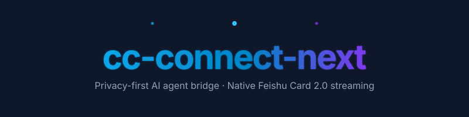

<div align="center">



**Use the AI coding agents on your computer from Feishu.**

Connect local agents such as Codex, Claude Code, and Cursor to Feishu/Lark, Telegram, Slack, Discord, and other chat platforms.

[](https://github.com/timmyagentic/cc-connect-next/releases/latest)
[](https://www.npmjs.com/package/cc-connect-next)
[](LICENSE)

[中文](README.md) · **[First-time setup](docs/getting-started.md)** · [Usage](docs/usage.md) · [Feishu setup](docs/feishu.md) · [Migration](docs/migration.md)

</div>

cc-connect-next is an independently maintained successor to [CC Connect](https://github.com/chenhg5/cc-connect), focused on native Feishu cards and local agent workflows. New users do not need the original CC Connect, an existing bot, or an old configuration.

It connects chat platforms to agents. **Install and authenticate your agent CLI separately, with access to the model you intend to use.** Code and agent processes run on your machine. Messages and final answers pass through the selected chat platform, and the agent sends model requests to its configured provider. Keep the host awake and online.

| Your starting point | Start here |
|---|---|
| Never used CC Connect or Next | **[First-time setup: prepare the host → create a bot → get a reply](docs/getting-started.md)** |
| Already use official CC Connect | [Migration guide](docs/migration.md), reusing your bot and configuration |
| Already use cc-connect-next | [Updates and services](INSTALL.md), or the [usage guide](docs/usage.md) |

## 🚀 Quick start

This example uses **Codex + Feishu**. The [first-time guide](docs/getting-started.md) includes macOS/Linux and Windows PowerShell commands, expected results, and troubleshooting.

**1. Prepare the host.** Install [Node.js LTS](https://nodejs.org/en/download) and confirm `node --version` and `npm --version` work. Follow the [official Codex CLI instructions](https://learn.chatgpt.com/docs/codex/cli), run `codex` in your project directory, sign in, and verify that it can answer a question. [Claude Code](https://code.claude.com/docs/en/overview) is another option; the first-time guide explains the configuration change.

**2. Install stable and create the configuration.** No repository clone or Go installation is needed.

```bash
npm install -g cc-connect-next
cc-connect-next --version
cc-connect-next
```

The first run creates a configuration and exits. **The bot is not running yet.** Open the printed `config.toml` path and set `work_dir` under `[projects.agent.options]` to an existing absolute project path. The starter uses Codex. Also choose the agent permission mode as described in the [configuration step](docs/getting-started.md#3-create-and-edit-the-configuration).

**3. Create the bot and check the host.** Keep the starter project name `my-project` and run:

```bash
cc-connect-next feishu setup --project my-project --no-recommended --no-lark-cli
cc-connect-next doctor
cc-connect-next
```

Scan the terminal QR code with the Feishu/Lark mobile app. The starter already contains the recommended card appearance, so these flags skip reapplying it and skip the optional `lark-cli` companion. `setup` configures the bot; it does not install or authenticate an agent or choose its working directory. Check the app's publication status and availability after registration.

**4. Verify a reply.** Keep the terminal running. Open a private chat with the bot, send `/version`, then ask “Briefly describe this project without changing files.” The first checks messaging; the second checks that the agent works. A passing `doctor` alone does not verify a real reply.

**5. Run in the background.** Once a reply succeeds, stop the foreground process with `Ctrl+C`, then install the service. On macOS/Linux:

```bash
cc-connect-next daemon install --config "$HOME/.cc-connect-next/config.toml"
cc-connect-next daemon status
```

See the [background service step](docs/getting-started.md#6-run-in-the-background) for Windows and custom paths. Use one process per configuration. A `config.toml` in the current directory takes precedence over the home-directory file; check the printed path or pass `--config` consistently.

## ✨ Highlights

- **Native Feishu answer cards.** Progress, streamed answers, and completion share a quoted card. Progress uses anonymous counts without reasoning text or tool details. The optional footer shows model, reasoning effort, and elapsed time. [Card contract](docs/feishu-card-contract.md)
- **Add instructions during a turn.** Codex's default app-server backend supports native steering; other agents fall back to a queue according to capability. `/ps` explicitly steers the current turn. [Queue and steer](docs/usage.md#busy-messages-queue-vs-steer)
- **Multiple projects and everyday controls.** Bind an agent, directory, and platforms per project; switch sessions, approve actions, select models/providers, schedule tasks, use voice, or open the web admin (beta). [Usage](docs/usage.md)
- **Diagnostics and maintenance.** `doctor` checks the host, daemon commands manage services, updates distinguish Stable/Beta, and migration retains backups and verification records. [Installation reference](INSTALL.md)
- **Queryable capabilities.** Ask the connected agent, or run `cc-connect-next capabilities --search "keywords"`, to inspect available configuration, commands, and permissions for the current version, project, and session. [Capability reference](docs/agent-capability-manifest.md)

## 🎬 What it looks like

<div align="center">

</div>

This is an illustration of the interaction. When steering adds a message to the same running turn, the previous card retains visible content and hands further progress and the answer to the card replying to the newest message. See the [card contract](docs/feishu-card-contract.md) for precise behavior.

## 🥇 Feishu as a first-class platform

WebSocket connections need no public IP, domain, or reverse proxy. The integration supports approval and model-selection cards, real topic isolation, group mention rules, files, and images. Start with a private chat, then configure groups and advanced features using the [Feishu guide](docs/feishu.md).

## 🧩 Supported agents & platforms

Common choices include Codex / Claude Code / Cursor / Gemini CLI and Feishu/Lark / Telegram / Slack / Discord. Default releases include the supported adapters; the authoritative inventory and selective-build options are `ALL_AGENTS` and `ALL_PLATFORMS` in the [Makefile](Makefile). External adapters can use the [Bridge protocol](docs/bridge-protocol.md).

## 🔄 Migrating from official CC Connect

Existing users can reuse their bot and configuration. Begin with a read-only check:

```bash
cc-connect-next migrate --dry-run
```

Then follow the [migration guide](docs/migration.md) for cutover, validation, and rollback. Two services must not consume events from the same Feishu app simultaneously. Next has its own command, `~/.cc-connect-next` directory, and service; migration preserves official binaries and data. See [Coming from CC Connect](docs/coming-from-cc-connect.md) for the differences.

## 📚 Documentation

| What you want to do | Guide |
|---|---|
| Install for the first time and get a reply | [First-time setup](docs/getting-started.md) |
| Install via npm, binary, or source; update, manage services, uninstall | [Installation reference](INSTALL.md) |
| Configure Feishu apps, permissions, events, and groups | [Feishu guide](docs/feishu.md) |
| Use sessions, approvals, models, schedules, and chat commands | [Usage guide](docs/usage.md) |
| Inspect settings, defaults, and capabilities | [Configuration](docs/configuration.md) · [Agent Capability Manifest](docs/agent-capability-manifest.md) |
| Migrate an official installation | [Migration](docs/migration.md) · [Compatibility matrix](docs/migration-compatibility.md) |
| Connect another chat platform | [Telegram](docs/telegram.md) · [Slack](docs/slack.md) · [Discord](docs/discord.md) · [More](docs/) |
| Build integrations | [Bridge protocol](docs/bridge-protocol.md) · [Management API](docs/management-api.md) |

For problems, start with the first-time guide's troubleshooting table, `doctor`, and daemon logs. Report issues through `/feedback` in chat or [GitHub Issues](https://github.com/timmyagentic/cc-connect-next/issues), removing credentials and private content from submitted material.

## 🛠️ Development & verification

```bash
make web            # Build the embedded web UI
make test-full      # Build, vet, race, smoke, and regression checks
make build-noweb    # Development build without the web panel
```

See [source prerequisites](INSTALL.md#current-source). Follow [AGENTS.md](AGENTS.md): core stays independent of agents/platforms, adapters expose optional capabilities, and behavioral fixes include regression tests.

## 🙏 Origin & license

cc-connect-next started from CC Connect v1.4.1, retains its Git history, and follows upstream through individual audits. Thanks to [@chenhg5](https://github.com/chenhg5) and all contributors. See [NOTICE](NOTICE) for attribution and [LICENSE](LICENSE) for the MIT terms.
