<div align="center">

# CC Connect Next

**从飞书话题发起任务，让 Codex 在本地仓库里工作。**

CC Connect Next 是一个独立维护的 [CC Connect](https://github.com/chenhg5/cc-connect) 衍生项目。它运行在你的电脑上，把飞书 / Lark 话题连到本地 Codex 会话。你在话题里交代任务、补充要求或处理审批，Codex 在绑定的工作区执行，结果回到原话题。

[](https://github.com/timmyagentic/cc-connect-next/releases/latest)
[](https://www.npmjs.com/package/cc-connect-next)
[](LICENSE)

**[开始使用](#首次安装交给-agent-执行)** · [官网](https://cc-connect-next.timmyagentic.si/) · [飞书配置](docs/feishu.md) · [English](README.en.md)

</div>

## ✨ 为飞书与 Codex 打磨

**接上团队已经聊过的事。** 团队在飞书的「订单接口」话题里定了方案。你接着问：「@Codex 刚才决定改哪个接口？对照仓库看看要改哪几处。」

开启群聊补读后，Codex 首次参与时会收到本话题的近期讨论，后续只补上次交付后的新消息。普通群聊按当前群补读。若方案来自另一个机器人，可以显式允许读取它在同一话题公开的答复。Codex 能分清谁提出了方案、谁在请它评审，再到这个话题绑定的本地仓库核对代码。[补读范围与对端机器人配置](docs/feishu.md#回复前补读近期讨论可选)

Codex 检查代码时，你能从飞书原生卡片看到进度。此时再发一句「也检查旧客户端是否兼容」，Codex app-server 可以把这条要求并入正在执行的回合（steer）。后续进度和最终答复接在这条补充消息下。新配置默认使用本地 app-server（stdio）；使用 Codex `exec` 后端时，忙时消息会排队。

## 🎬 协作示意

<div align="center">

</div>

*消息流示意，非实机录屏。* 中途补充后，旧卡片保留已显示的内容，后续进展和最终结果接续到回复最新消息的卡片中。

## 🚀 快速开始

推荐使用 **已安装并登录的 Codex CLI + 飞书 / Lark 机器人**。飞书通过长连接接入，无需公网 IP、域名或证书。支持 macOS、Linux 和 Windows；npm 安装需要 Node.js/npm。

### 首次安装：交给 Agent 执行

将下面的 Prompt 交给能执行本机命令的编码 Agent，由它完成安装、配置和验证。登录、扫码或应用发布需要你配合完成。

<details>
<summary><strong>展开并复制：安装 Codex + 飞书 / Lark</strong></summary>

```text
请从 https://github.com/timmyagentic/cc-connect-next 安装已发布稳定版，使用 Codex 接入飞书/Lark。
先确认操作系统、CPU 架构、Node.js/npm、Codex CLI 及登录状态和项目绝对路径；
缺少 Codex CLI 时协助安装，登录由我完成；优先复用当前项目，缺少必要信息再问我。
检查并保留已有 CC Connect/Next 配置和服务，不执行迁移或覆盖。
选择明确的配置绝对路径；文件不存在时运行 `cc-connect-next --config <配置路径>` 生成配置，
由你填写真实 work_dir，Agent 类型使用 codex、backend 使用 app_server、app_server_url 使用 stdio，
保持项目名一致，不让我手工编辑配置。
执行 `cc-connect-next feishu setup --config <配置路径> --project <项目名> --recommended --no-lark-cli`，
展示二维码并保持进程等待我扫码，完成机器人配置。
执行 `cc-connect-next doctor --config <配置路径>`，再用
`cc-connect-next --config <配置路径>` 前台启动；引导我在机器人私聊发送 /version、/whoami
和一条普通提问，核对回复并按实际用户 ID 配置访问范围。
验证后停止本次前台进程，执行 `cc-connect-next daemon install --config <配置路径>`，检查
`cc-connect-next daemon status` 的服务状态、Runtime 和平台就绪状态，并验证后台仍能回复。
报告版本、配置路径、work_dir 和验证结果；需要我登录、扫码或发布应用时再提示，
未完成的真实消息验证明确标为 UNVERIFIED。
```

</details>

[首次安装说明](docs/getting-started.zh-CN.md) · 已有官方 CC Connect？使用[迁移 Prompt](docs/migration.zh-CN.md#交给-agent-一键执行)。

### 手动安装

先安装并登录 Codex CLI，然后安装稳定版并生成配置：

```bash
npm install -g cc-connect-next@latest
cc-connect-next --config ~/.cc-connect-next/config.toml
```

首次运行会生成配置并给出指引。先将 `projects.agent.options.work_dir` 改为真实项目绝对路径，保留 Codex 的 `app_server` / `stdio` 设置；机器人凭据由下一步 `feishu setup` 填写。

```bash
cc-connect-next feishu setup --config ~/.cc-connect-next/config.toml --recommended --no-lark-cli
cc-connect-next doctor --config ~/.cc-connect-next/config.toml
cc-connect-next --config ~/.cc-connect-next/config.toml
```

在机器人私聊发送 `/version`、`/whoami` 和一条普通提问，确认 Codex 能正常回答，并按实际用户 ID 配置访问范围。`doctor` 通过不代替真实消息验证。跑通后停止前台进程，再安装为后台服务并复测：

```bash
cc-connect-next daemon install --config ~/.cc-connect-next/config.toml
cc-connect-next daemon status
```

以上命令采用 macOS/Linux 路径；Windows 请使用配置文件的绝对路径。独立二进制、源码安装与更新见 [INSTALL.md](INSTALL.md)。

<a id="-支持的-agent-与平台"></a>

## 🧩 兼容说明

飞书 / Lark 与 Codex 是主要优化组合。也可以连接 Claude Code、Cursor、Gemini CLI、OpenCode 等 Agent，以及 Telegram、Slack、Discord 等平台；完整配置见[配置参考](docs/configuration.zh-CN.md)与[平台指南](docs/)。

各组合支持的卡片、审批和中途并入能力不同。不支持原生并入时，普通忙时消息回退到排队；详见[排队与并入说明](docs/usage.zh-CN.md#忙时消息排队-vs-并入steer)。

定时任务、Web 管理台（Beta）、语音、反馈和官方 lark-cli 等扩展能力，集中在下方文档中介绍。

## 🔄 从官方 CC Connect 迁移

Next 拥有独立的命令、数据目录和服务。迁移可以复用原有飞书机器人，并保留官方安装与数据。先查看计划：

```bash
cc-connect-next migrate --dry-run
```

需要切换服务时，按[迁移指南](docs/migration.zh-CN.md)执行 `migrate --switch`；该操作会停止并禁用官方服务，再启动 Next。差异说明、兼容范围与回滚步骤见[写给官方用户](docs/coming-from-cc-connect.zh-CN.md)和[迁移兼容矩阵](docs/migration-compatibility.md)。

## 🔒 数据与权限

Codex 在本机工作区执行，消息和最终答案会经过飞书 / Lark，模型请求会发送给配置的服务提供方。原生回答卡片隐藏处理中间的推理和工具明细；最终答案引用的代码仍会随回复发送。

访问范围和 Codex 权限模式由配置控制。具体说明见[权限模式](docs/usage.zh-CN.md#权限模式)与[卡片隐私边界](docs/feishu-card-contract.md#privacy-boundary)。

## 📚 详细文档

| 文档 | 内容 |
|---|---|
| [首次安装](docs/getting-started.zh-CN.md) · [安装参考](INSTALL.md) | 从安装到真实回复、后台服务与更新 |
| [飞书配置](docs/feishu.md) | 应用、权限、话题、群聊与可选 lark-cli 接入 |
| [使用指南](docs/usage.zh-CN.md) | 会话、模型、权限、定时任务、语音与反馈 |
| [配置参考](docs/configuration.zh-CN.md) | Codex 后端、推荐配置及其他适配器选项 |
| [能力查询](docs/agent-capability-manifest.zh-CN.md) | 让 Agent 查询当前项目支持什么、如何调用 |
| [管理 API](docs/management-api.zh-CN.md) · [Bridge 协议](docs/bridge-protocol.zh-CN.md) | 外部控制与自定义平台适配器 |
| [卡片契约](docs/feishu-card-contract.md) · [反馈与更新契约](docs/agent-app-features.zh-CN.md) | 生命周期、隐私边界与内部实现 |
| [更新日志](https://github.com/timmyagentic/cc-connect-next/releases) | 稳定版与 Beta 的功能及使用条件 |

## 🛠️ 开发与验证

架构、适配器接口与验证要求见 [AGENTS.md](AGENTS.md) 和 [CONTRIBUTING.md](CONTRIBUTING.md)。核心层不依赖 Agent 或平台适配器，扩展通过能力接口注册。

```bash
make web
go test ./... -count=1
make build-noweb
```

## 🙏 来源与许可证

cc-connect-next 是从 [CC Connect](https://github.com/chenhg5/cc-connect) v1.4.1 派生的独立项目，保留完整 Git 历史，通过[逐项审计](docs/upstream-v1.5.0-beta.3-audit.md)引入上游改动。感谢 [@chenhg5](https://github.com/chenhg5) 与所有上游贡献者。归属声明见 [NOTICE](NOTICE)，MIT 许可条款见 [LICENSE](LICENSE)。

### Per-task Codex speed

Prompt cron jobs support `--service-tier` on creation and `cron edit <id> service_tier priority`.
The optional `service_tier` field is applied to that task turn and validated against the model
catalog. An empty value inherits the existing project/session setting. Shell jobs cannot use
this field. For example, `cc-connect-next cron edit <id> reasoning_effort medium` and
`cc-connect-next cron edit <id> service_tier priority` configure reasoning and speed independently.

Use the model catalog's tier ID. For Luna the display name Fast maps to `priority`.
