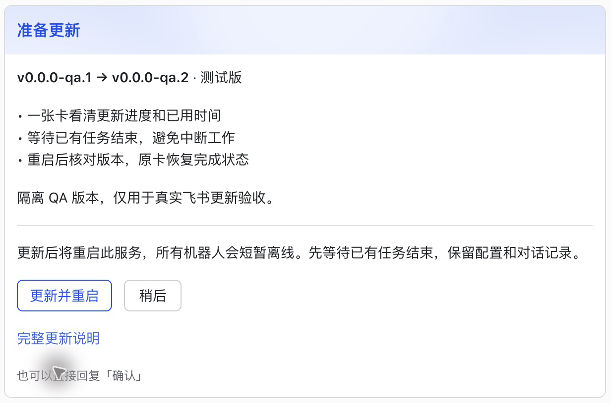
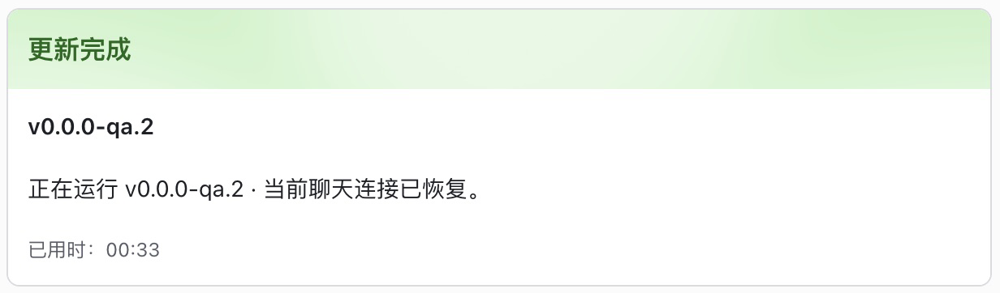

# Chat update experience

Administrators can open the update reminder or send `/upgrade`. The confirmation
shows the current and target versions, a short release summary, any explicit
upgrade warnings, and the effect of restarting the shared service. Installation
requires **Update and restart** (or **Update when tasks finish**). The full release
notes remain a separate link. `/upgrade stable` and `/upgrade beta` select a
channel; confirmation always applies the exact reviewed plan.

On Feishu, the reminder, check, confirmation, progress, and recovered result edit
the same message. Progress uses actual installer events and elapsed time, without
invented percentages or estimates. npm reports its installation process and the
subsequent installed-version verification; standalone installs additionally
report archive download and package verification.

## Work and cancellation

All Engines in the service share one update coordinator. Interactive work,
accepted queues, Shell/custom/skill commands, scheduled jobs, heartbeats, and
relay requests hold an activity admission until their work finishes. Confirming
an update closes admission to new work and waits for accepted work to drain.
Permission replies and stop controls remain usable. The task count describes
admitted work in the service, without exposing other users' messages.

Checking and waiting can be cancelled. Cancellation releases admission and does
not stop existing tasks. Installation is not offered as cancellable once the
installer takes ownership. Duplicate confirmations return the active operation;
another administrator cannot cancel it. Manual/API/deferred restarts cannot
interrupt an active installation, and an already accepted restart prevents a new
installation from starting.

Checks have a 45-second limit, waiting has a 30-minute limit, and installation has
a 10-minute limit. npm runs in an isolated process group so a timeout does not
leave its installer children writing files. A failure after installation starts
is reported as potentially changing installed files; it never claims cancellation
or an unchanged installation, and does not restart automatically. A retry of the
same plan is offered only for a recoverable failure before installation starts.

## Restart and recovery

Before installation and restart, the service atomically saves the operation,
versions, installation method, owner, exact card reference, and delivery state in
`data_dir/run/update-results/<operation-id>.json` (0600, directory 0700). Routing
references contain no credentials. Each result is separate so another attempt
cannot overwrite an undelivered result.

The new process compares its actual version with the expected target before
showing completion. It also waits for the originating connection to be usable.
Other unavailable connections are described separately and the card is refreshed
when they recover. Completion only proves the running version and connection
state; it does not certify model access or macOS privacy permissions.

Delivery retries are bounded and triggered by startup or connection recovery.
Unsent results stay on disk. Progress never creates replacement messages after
an edit failure; the final result can create one replacement if needed. Delivered
receipts are deduplicated. `/upgrade status` reads the saved result and an old
consumed confirmation shows its corresponding outcome. Unsupported platforms
fall back to readable stage transitions and normal confirmation controls.

If the new process cannot start, no in-process code can update the chat. On the
host, inspect `cc-connect-next daemon status`, `cc-connect-next doctor`, and the
installed binary's `--version`; compare the service's executable path with the
installation that was updated. Keep any installer recovery backup. Repair that
installation or service path, then restart the daemon. The saved result is
reconciled on startup. Do not blindly repeat an npm install after an uncertain
installation result.

## Release summary format

Publish up to three short bullets under `### Highlights` / `### 更新亮点`, within
the existing `## English` / `## 中文` sections. Put required migrations, permission
changes, and breaking changes under `### Upgrade notes` / `### 升级注意` (or
`Breaking changes`). Explicit warning sections are kept intact in the confirmation.
Older notes fall back to three bounded bullet headings and a full-notes link.

## Verification boundaries

The screenshots above are from a real Feishu desktop session using the opt-in
[QA harness](../tests/manual/updateqa/README.md). The npm install, checksum check,
version probe, executable replacement, process restart, same-card receipt, and
post-update `/version` message were exercised with isolated `v0.0.0-qa.1` →
`v0.0.0-qa.2` fixtures. The release source was loopback and archive transfer was
throttled for about 30 seconds. These are not published releases or a production
service upgrade.

Automated tests cover both standalone and npm update contracts, exact plans,
concurrency, cancellation, failed persistence/delivery, wrong running versions,
partial connection recovery, restart ordering, installer-child termination, and
Feishu reference binding. The CUJ drives real Engine message entry points through
cross-project work, update confirmation, restart, and an old confirmation click.

Physical phone layout, screen-reader behavior, signed release migration, and
macOS TCC continuity under launchd remain **UNVERIFIED** by this fixture. Check
those separately before claiming release or permission continuity acceptance.
