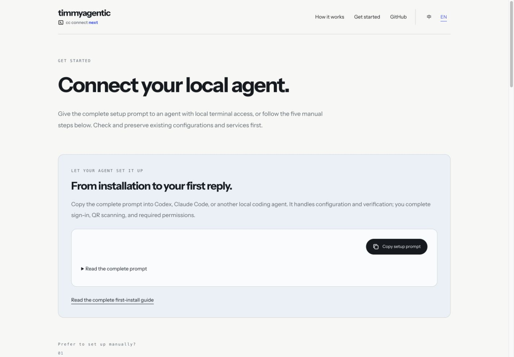
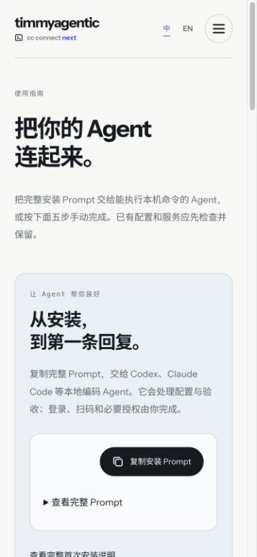

# Website polish QA — 2026-10-25

The complete README setup prompt is available before five manual steps: Agent readiness, explicit configuration/work_dir, Feishu, a real reply, and background operation. Repository guide links follow the display language.

Validated in a local browser at 1440 × 1000 and 390 × 844; the page also has no horizontal overflow at 320 px. Visible images loaded. Social metadata resolves to a 1200 × 630 image. Screenshots below are unmodified browser captures of the candidate.

Checks passed: `make web`, `go build ./...`, `go test ./...` and `npm --prefix website run check`.

Both collapsed setup prompts were copied and read back: English 1,657 characters and Chinese 835 characters, exactly matching the page content. The permission-denied clipboard fallback is not independently exercised.

This is website acceptance. Live installation, authentication, production hardware/network operations, and native client acceptance are outside this change. A successful local check does not prove production deployment; the reviewed commit must be deployed and read back separately.

